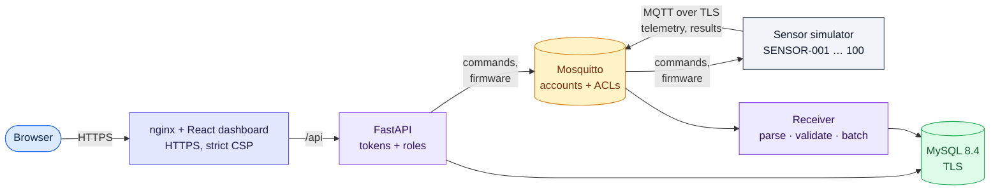

# SmartIoT — Smart-Home Monitoring & Quality Engineering Platform

[](https://github.com/Arshaduzzaman3620/smart-iot-qa-platform/actions/workflows/ci.yml)


[](LICENSE)

> A complete smart-home monitoring system — simulated sensors, a secure web dashboard, remote device control and over-the-air updates — built the way a real product is: in small, verified steps, tested at every level, secured, measured under load and documented end to end.

**In plain terms:** sensors in every room report temperature, humidity, air pressure, light and battery. The platform collects those readings, checks them, stores them, raises alerts when something is wrong, and shows everything on one secure dashboard where you can control devices and install updates remotely. Everything runs on a single laptop with one command — no hardware needed.

Built and tested end to end by **Arshaduzzaman** as a portfolio of professional Software Quality Assurance and test automation. One-page summary for reviewers: **[project brief](docs/project-brief.md)**.

---

## Highlights at a glance

| | |
|---|---|
| ✅ **816 automated tests** across 7 layers | from single functions to the full system in a real browser — all passing |
| 🛡️ **Security built in, proven by tests** | TLS everywhere, role-based access, brute-force protection, dependency audits, a pre-launch security review |
| ⚡ **303 requests/second, 0 % errors** | at 300 concurrent users — after load testing found and fixed a throughput collapse (up from 124) |
| 🔁 **Zero data lost** | no reading lost or duplicated when the database, broker or receiver was killed mid-operation |
| 📋 **11 / 11 requirements traced** | every requirement linked to the tests that prove it |
| 🐛 **41 defects found and fixed** | each now guarded by a regression test |
| 🤖 **AI-assisted QA** | a Claude-powered tool turns written requirements into test cases and explains failing runs |

Full evidence: **[Final QA report](docs/testing/final-report.md)**.

---

## See it running in five minutes

The only requirement is [Docker Desktop](https://www.docker.com/products/docker-desktop/). The same commands work on macOS, Windows and Linux.

```bash
docker compose up -d --build        # start the whole platform with 5 simulated sensors
```

Then open:

| What | Where | Notes |
|---|---|---|
| **Dashboard** | https://localhost:8443 | sign in as `admin` / `admin-dev-password` |
| **Emails** | http://localhost:8025 | local inbox for welcome and password-reset emails |
| **API docs** | https://localhost:8443/api/docs | interactive REST reference |

> First visit: trust `certs/ca.crt` or the browser will warn about the self-signed certificate ([why](docs/security/tls.md)).

```bash
docker compose -f compose.test.yaml run --rm --build tests      # run all 816 tests (~5 min)
docker compose --profile perf run --rm k6 run -e PROFILE=load /scripts/api.js   # load test
docker compose down                                             # stop everything
```

Running it with Python and Node on the host instead, plus troubleshooting: [development setup](docs/development/setup.md).
Deploying it to a real server: **[deployment guide](docs/deployment.md)** — the passwords above are development defaults and are refused in production.

---

## What it does

| Area | What it does | Docs |
|---|---|---|
| **Live home overview** | One screen: devices online, average temperature and humidity, and anything needing attention, refreshed every few seconds | [dashboard](docs/frontend/dashboard.md) |
| **Alerts** | Low battery, out-of-range temperature, high humidity and offline devices, with escalation and hysteresis | [alerts](docs/architecture/alerts.md) |
| **Device control** | Restart a device, request a fresh reading, change how often it reports — each outcome tracked | [commands](docs/architecture/commands.md) |
| **Remote firmware updates** | Upload a version and install it over the air; a failed or interrupted update leaves the device on its previous version | [FOTA](docs/architecture/fota.md) |
| **Secure access** | Sign-in with three roles (viewer, operator, admin); admins create and remove accounts | [auth](docs/api/auth.md) |
| **Account recovery** | Forgot username or password by email, with a one-time, time-limited reset link | [accounts](docs/api/auth.md#accounts-and-recovery-phase-19) |
| **Reliability** | At-least-once delivery with de-duplication through database, broker and receiver outages | [reliability](docs/testing/reliability.md) |
| **Security & TLS** | Broker accounts and ACLs, encrypted connections everywhere, strict CSP, hostile-input tests, production safety checks | [security](docs/security/security.md), [TLS](docs/security/tls.md) |

---

## How it fits together



Each part has a single responsibility and can be tested on its own. Full component, data-flow, security and deployment diagrams: **[architecture](docs/architecture/architecture.md)**.

---

## Built with

| Layer | Technology |
|---|---|
| Sensor simulator | Python, paho-mqtt |
| Message broker | Mosquitto (MQTT), password file + ACLs |
| Receiver | Python, paho-mqtt (persistent session, manual acks), SQLAlchemy |
| Backend API | Python, FastAPI, Pydantic, SQLAlchemy, PyJWT |
| Database | MySQL 8.4 |
| Frontend | TypeScript, React, Vite; nginx in production |
| Test automation | pytest, httpx, Playwright (Python), paho-mqtt |
| Performance | k6 |
| AI-assisted QA | Claude API (Anthropic Python SDK, structured outputs) |
| TLS | Private CA generated with `cryptography`; nginx (HTTP/2), Mosquitto 8883, MySQL `require_secure_transport` |
| Containers & CI | Docker Compose, GitHub Actions (tests, full-stack start, dependency audit) |

---

## What this project demonstrates

Test strategy and planning · Test automation at every level (unit, API, integration, UI, end-to-end) · Performance and reliability testing · Security testing and a pre-launch review · Defect analysis and reporting · Requirements traceability · CI/CD · Docker · Python and TypeScript development · Technical documentation · AI-assisted testing.

The work was delivered in **19 verified phases**, each one built to scope, checked by hand on the running system, covered by tests for normal use, invalid input and edge cases, documented, and merged through a pull request with automated checks — the way quality-focused teams ship software. History and roadmap: [PROJECT_PLAN.md](PROJECT_PLAN.md).

---

## Documentation

**Start here:** [project brief](docs/project-brief.md) · [architecture](docs/architecture/architecture.md) · [final QA report](docs/testing/final-report.md) · [deployment guide](docs/deployment.md)

<details>
<summary><strong>All documents</strong></summary>

- [Requirements](docs/requirements/requirements.md)
- [Development setup](docs/development/setup.md)
- [Sensor behaviour](docs/architecture/sensor-behavior.md)
- [MQTT topic design](docs/mqtt/topics.md)
- [Database structure](docs/architecture/database.md)
- [REST API](docs/api/endpoints.md)
- [Authentication and roles](docs/api/auth.md)
- [Web dashboard](docs/frontend/dashboard.md)
- [Testing strategy](docs/testing/strategy.md)
- [Test automation](docs/testing/automation.md)
- [Manual end-to-end verification](docs/testing/e2e-manual-verification.md)
- [Multi-sensor scale results](docs/testing/scale-results.md)
- [Alerts and offline detection](docs/architecture/alerts.md)
- [Sensor commands](docs/architecture/commands.md)
- [Firmware over the air](docs/architecture/fota.md)
- [Reliability and failure injection](docs/testing/reliability.md)
- [Security](docs/security/security.md) and [TLS](docs/security/tls.md)
- [Performance](docs/testing/performance.md)
- [AI QA assistant](docs/testing/ai-qa-assistant.md)

</details>

---

<sub>Licensed under [Apache 2.0](LICENSE). Sensors are simulated in software, so the whole system runs on one machine with no hardware.</sub>
