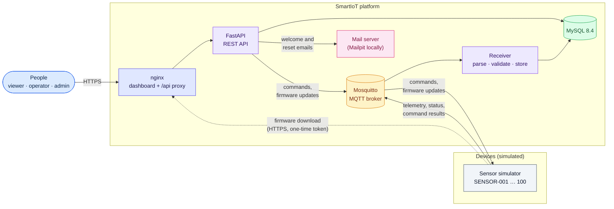
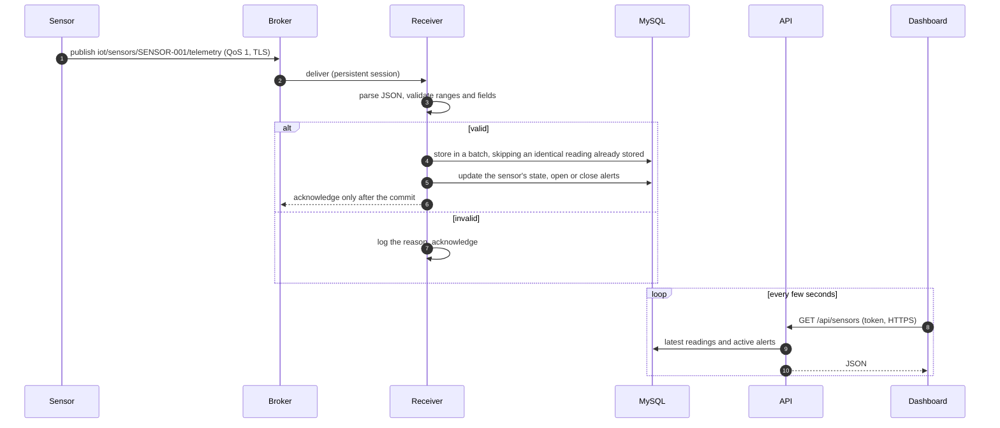
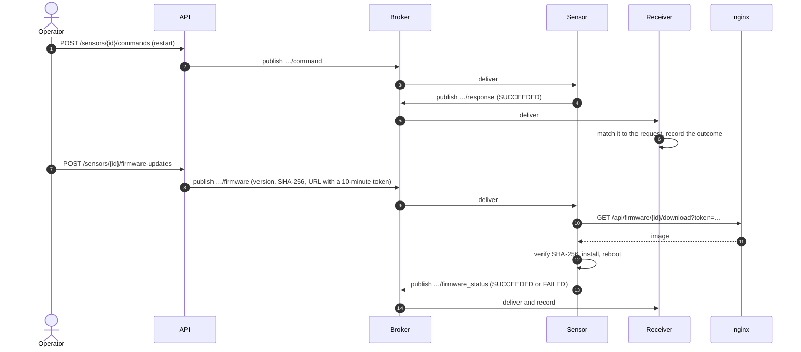
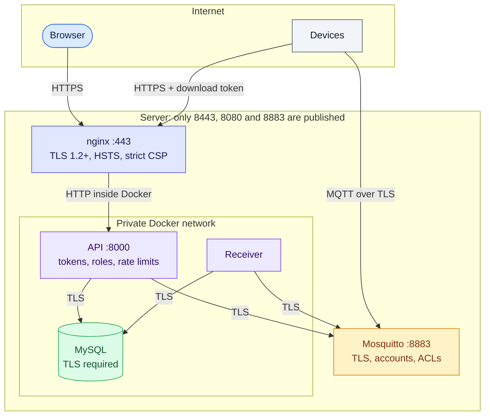
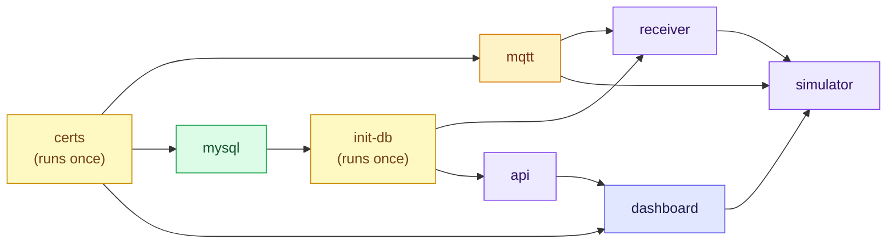

# Architecture

SmartIoT is a set of small services, each with a single responsibility, connected by MQTT (devices) and HTTPS (people). Every connection is encrypted and authenticated, and every service runs in its own container.

- [System overview](#system-overview)
- [Components](#components)
- [Telemetry: from a sensor to the screen](#telemetry-from-a-sensor-to-the-screen)
- [Commands and firmware updates](#commands-and-firmware-updates)
- [Security boundaries](#security-boundaries)
- [Deployment view](#deployment-view)
- [Design principles](#design-principles)

## System overview

## Components

| Component | Responsibility | Code | Details |
|---|---|---|---|
| Sensor simulator | Generates realistic readings for up to 100 sensors, answers commands, installs firmware; can inject faults | `sensor-simulator/` | [sensor behaviour](sensor-behavior.md) |
| MQTT broker | Routes device messages; one account per role, topic ACLs, TLS on 8883 | `docker/mosquitto/` | [topics](../mqtt/topics.md) |
| Receiver | Parses and validates every message, stores telemetry in batches, raises alerts, detects offline sensors, records command and firmware outcomes | `receiver/` | [alerts](alerts.md) |
| Database | Sensors, telemetry, alerts, commands, firmware, users, reset links; schema created and upgraded at start | `database/` | [database](database.md) |
| REST API | Sign-in and roles, sensor data, alerts, commands, firmware, user administration, account recovery | `backend/app/` | [endpoints](../api/endpoints.md), [auth](../api/auth.md) |
| Dashboard | React single-page app served by nginx over HTTPS, which also proxies `/api` | `frontend/`, `docker/nginx.conf.template` | [dashboard](../frontend/dashboard.md) |
| Certificates | Creates a private CA and server certificate on first start, or uses real ones | `docker/tls/` | [TLS](../security/tls.md) |
| Test framework | Unit, API, MQTT, integration, reliability, UI and end-to-end tests; k6 load tests | `tests/`, `perf/` | [strategy](../testing/strategy.md) |
| AI QA assistant | Turns requirements into test cases and explains failing runs, using the Claude API | `qa-assistant/` | [AI QA assistant](../testing/ai-qa-assistant.md) |

## Telemetry: from a sensor to the screen

A reading is acknowledged only after it is stored, so a receiver or database outage delays data but never loses it, and a redelivered reading is recognised and stored once ([reliability](../testing/reliability.md)).

## Commands and firmware updates

A command or update with no answer becomes `TIMED_OUT`. A failed or interrupted install leaves the sensor on its previous version ([commands](commands.md), [FOTA](fota.md)).

## Security boundaries

| Boundary | Control |
|---|---|
| Browser → dashboard | HTTPS only (HTTP redirects), HSTS, a Content Security Policy with no inline code, security headers |
| Dashboard → API | Signed tokens (HS256, algorithm pinned), three roles checked on every request, sign-in and reset rate limits |
| Devices → broker | TLS, a password per account, topic ACLs, no anonymous access |
| Services → MySQL | TLS required by the server, a dedicated user, no root access from the app |
| Production start | `APP_ENV=production` makes the API and the broker refuse development passwords, weak secrets and missing TLS |

Threats, controls and test evidence: [security](../security/security.md) and [TLS](../security/tls.md).

## Deployment view

Arrows show start order: each service starts once the ones before it are ready.

| Service | Image | Published port |
|---|---|---|
| `dashboard` | nginx 1.27 + built React app | 8443 (HTTPS), 8080 (redirect) |
| `mqtt` | eclipse-mosquitto 2 | 8883 (TLS); 1883 on 127.0.0.1 only |
| `api` | Python 3.12, non-root | 8000 on 127.0.0.1 only |
| `mysql` | mysql 8.4 | 3307 on 127.0.0.1 only |
| `receiver`, `simulator` | Python 3.12, non-root | none |
| `mailpit` | axllent/mailpit (local inbox) | 8025 on 127.0.0.1 only |

Running it on a server: [deployment guide](../deployment.md).

## Design principles

- **One responsibility per service**, and per module inside each service, so every part can be tested alone.
- **Never trust input.** Every MQTT message is parsed and validated before it touches the database; every API request is checked against a schema and a role.
- **At least once, stored once.** Acknowledge after the commit; recognise redelivered readings.
- **Secure by default.** Encryption everywhere, least-privilege accounts, and a production mode that refuses unsafe settings.
- **Configuration in the environment** (`.env`, see `.env.example`), never in code.
- **Built in verified phases**: [PROJECT_PLAN.md](../../PROJECT_PLAN.md).
